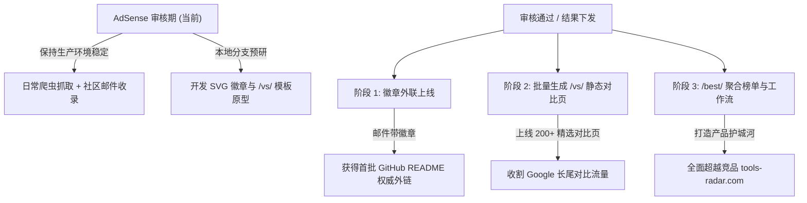

# ToolsRadar 进阶拓展与竞品对标实施方案 (Growth & Expansion Blueprint)

> **文档状态**：待执行（AdSense 审核后启动）  
> **制定时间**：2026-10-28  
> **对标对象**：`https://tools-radar.com/` (React SPA 架构，收录 6000+ AI 工具)  
> **核心原则**：保持 Astro SSG 极致性能与 SEO 满分壁垒，将内容面拓展 300%，建立反向链接（Backlinks）增长飞轮。

---

## 目录
1. [竞品深度剖析与我方护城河](#1-竞品深度剖析与我方护城河)
2. [实施策略与风险控制（AdSense 审核窗口）](#2-实施策略与风险控制)
3. [模块一：全站“深度对比矩阵”引擎 (`/vs/[tool-a]-vs-[tool-b]`)](#3-模块一全站深度对比矩阵引擎)
4. [模块二：创始人外联 & 官方认证徽章飞轮 (Founder Outreach & Badge)](#4-模块二创始人外联--官方认证徽章飞轮)
5. [模块三：开发者技术栈与工作流组装器 (`/workflow`)](#5-模块三开发者技术栈与工作流组装器)
6. [模块四：高意图主题榜单与零订阅税看板 (`/best/` & `/price-compare`)](#6-模块四高意图主题榜单与零订阅税看板)
7. [分步执行路线图 (Actionable Milestones)](#7-分步执行路线图)

---

## 1. 竞品深度剖析与我方护城河

经过对 `tools-radar.com` 的前端打包文件、Supabase 数据表及路由逆向，核心特征如下：

| 对比维度 | 对标竞品 (`tools-radar.com`) | ToolsRadar 现状与超越策略 (`lordorange.top`) |
| :--- | :--- | :--- |
| **底层架构** | **React SPA (Vite)**：6000+ 页面全部返回同一个 5KB 壳，无 SSR，爬虫需执行 JS 才能解析。 | **Astro SSG 纯静态**：每个页面生成独立预渲染 HTML，TTFB < 50ms，100% 爬虫无损索引。 |
| **收录定位** | 泛商业 AI 工具（大量壳子产品、营销文案生成器）。 | **高信号开发者软件、开源基础设施、自托管、零免签**。 |
| **杀手级功能** | 1,770 个两两对比页 (`/vs/`)、AI 工作流组装器 (`/workflow`)、价格对比器 (`/price-compare`)。 | **必须吸收借鉴**，以静态预渲染形态重新实现，速度与 SEO 效果高其一个量级。 |
| **外联机制** | 后台自研 `/admin/tool-outreach`，抓取创始人邮箱批量通知“已被收录”，引导回链。 | **建立专属极客徽章体系**，借助 Resend 邮件系统自动化获取开源作者的 GitHub README 反向链接。 |

---

## 2. 实施策略与风险控制

### 2.1 审核等待期的“冻结与准备”原则
- **线上生产环境（`main` 分支）**：
  - 严禁上线未完全跑通的大规模路由；
  - 保持每日爬虫自动化维护与时间戳微更新（向 Google 证明网站处于高频活跃维护中）；
  - 保持当前的 879 个高质量静态路由极速稳定。
- **本地研发环境（`feat/expansion` 分支）**：
  - 提前写好组件模板、数据关联算法、SVG 徽章生成器及测试用例；
  - 确保 AdSense 结果出来后，可以在 24 小时内无缝上线。

---

## 3. 模块一：全站“深度对比矩阵”引擎

### 3.1 目标与 SEO 价值
“Tool A vs Tool B”（如 `Postiz vs Buffer`、`Coolify vs Vercel`、`Claude Code vs Cursor`）在 Google 搜索中属于 **High-Intent / High-CPC 黄金关键词**，跳出率低且用户购买/试用倾向极强。

### 3.2 路由与数据生成设计
- **目标路由**：`/vs/[toolA]-vs-[toolB]/`（如 `/vs/postiz-vs-buffer/` 或 `/vs/coolify-vs-vercel/`）
- **数据源绑定**：
  利用 `data/all_tools.json` 中的现有字段：
  - `primary_alternative`（已有 743 个工具具备此字段）
  - `comparison_vs_alt`（深度手写/AI 提炼的选型对比结论）
  - `signal_score`, `pricing_model`, `is_self_hostable`, `stars`, `key_features`
- **页面核心模块**：
  1. **Hero 快速结论 (Head-to-Head Verdict)**：直接给出“选 Tool A 的理由”与“选 Tool B 的理由”；
  2. **5 维度量化雷达表**：
     - Setup & Onboarding（免登录与安装速度）
     - Code & Auditability（开源许可证与可审计性）
     - Maintenance & Vitality（GitHub Stars 与活跃度）
     - Cost Advantage（自托管/免费 vs SaaS 订阅税）
     - Community Signal（综合雷达信号分）
  3. **功能矩阵打钩表 (Feature Breakdown)**；
  4. **快速启动命令对比**（如 `docker compose up` vs 官方 SaaS 入口）。
- **Schema.org 结构化数据**：
  注入 `@type: "Product"` 并列出两款产品的评分与定价，极易在 Google 搜索结果中展示对比丰富摘要（Rich Snippets）。

---

## 4. 模块二：创始人外联 & 官方认证徽章飞轮

### 4.1 核心机制
当工具被 ToolsRadar 收录并评为高信号项目后，向项目创始人/维护者发送通知邮件，并赠送专属的“嵌入式认证徽章（Embeddable Badge）”。当作者将徽章放置在 GitHub README 或项目官网页脚时，ToolsRadar 将获得永久高权重 Dofollow 反向链接。

### 4.2 徽章规格与端点 (`/badge/[id].svg`)
在 Astro 中建立动态 SVG 端点：`site/src/pages/badge/[id].svg.ts`。

**极客黑客风 SVG 规范**：
- 尺寸：`200px x 36px`（适合 GitHub README 顶部排版）
- 视觉：深黑网格背景、绿灰边框、雷达脉冲图标、动态信号分
```markdown
[](https://lordorange.top/tool/postiz)
```
- **HTML 嵌入代码**：
```html
<a href="https://lordorange.top/tool/postiz" target="_blank">
  
</a>
```

### 4.3 创始人邮件模板升级 (SOP)
在现有 Resend 发送脚本（`scripts/send_founder_reply.py`）中增加“收录通知与徽章附赠”：
- **邮件主题**：`🎯 [Featured] {Tool Name} is now radar-indexed on ToolsRadar!`
- **正文结构**：
  1. 祝贺项目上线，附带专属 Dossier 页面链接；
  2. 简述收录评级（如 Signal Score: 99 / 100）；
  3. 附上 Markdown 与 HTML 徽章代码，方便作者一键贴到 GitHub README。

---

## 5. 模块三：开发者技术栈与工作流组装器 (`/workflow`)

### 5.1 概念定位
区别于竞品单纯罗列工具，ToolsRadar 的工作流定位为：**“Architect & Indie Stack Builder”**。

### 5.2 核心流程
1. **输入意图**：开发者输入自己的项目需求（如：*“构建一个带向量检索的多 Agent 爬虫系统”* 或 *“自托管的个人品牌跨平台发帖流水线”*）；
2. **流水线分解**：系统自动将架构划分为 4 个标准阶段：
   - Phase 1: Ingestion & Scraping（采集）
   - Phase 2: Processing & LLM Router（处理与模型路由）
   - Phase 3: Database & State（存储与向量状态）
   - Phase 4: Delivery & Frontend（展现与交付）
3. **工具智能匹配**：从站内 800+ 库中为每个 Phase 精准推荐 1~2 款最优开源/免费工具；
4. **交付物生成**：
   - 提供推荐工具的组合评分；
   - 自动拼装一键启动的 `docker-compose.yml` 配置文件模板；
   - 支持一键导出为 Markdown 或打印为架构方案 PDF。

---

## 6. 模块四：高意图主题榜单与零订阅税看板

### 6.1 精选落地页 (`/best/[topic]`)
为高频搜索意图建立专有 Landing Pages（静态预渲染）：
- `/best/open-source-developer-tools`
- `/best/self-hostable-alternatives`
- `/best/free-coding-agents`
- `/best/privacy-first-analytics`
- `/best/ai-web-scraping-apis`

每个页面包含：
- 该品类的选型决策树；
- 按照 `signal_score` 降序排名的 Top 10 工具深度评测；
- 痛点分析与成本节省测算。

### 6.2 零订阅税看板 (`/price-compare`)
- 设立 **“Zero Subscription Tax” 筛选维度**：
  - 100% Free / Open Source
  - Self-Hostable
  - No Credit Card Required
- **计算看板**：显示使用本站开源自托管方案相较于商业 SaaS（如 DataDog、Buffer、Notion Team、Zapier）**每年为独立开发者团队节省的平均成本（如“平均年省 $4,800+”）**。

---

## 7. 分步执行路线图



### 阶段执行清单：
1. **阶段 0（当前审核期）**：
   - 稳定维护现有生产环境；
   - 正常处理每日邮件与 GitHub Issues。
2. **阶段 1（审核后第 1 周）**：
   - 上线 `site/src/pages/badge/[id].svg.ts` 徽章生成器；
   - 在邮件模板中加入 Badge 复制指引。
3. **阶段 2（审核后第 2 周）**：
   - 上线首批 100~200 个高质量 `/vs/[pair]` 静态对比页；
   - 增加站内交叉内链（在各工具详情页增加“与 X 对比”直达入口）。
4. **阶段 3（审核后第 3-4 周）**：
   - 推出 `/best/` 系列主题聚合页；
   - 研发测试 `/workflow` 架构组装器。
